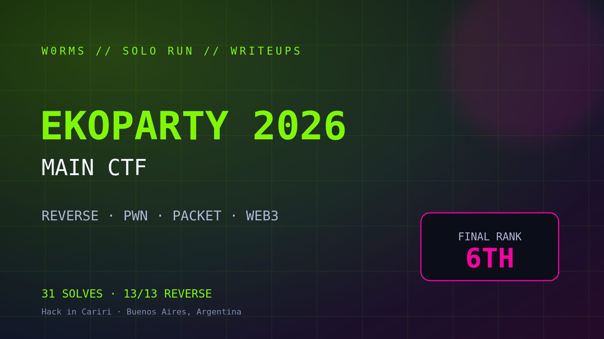

<div align="center">



# EKOPARTY 2026 — CTF

**Hack in Cariri · 6th place · Team `W0rms`**

[](#verified-solves)
[](#exact-flags-retained)
[](writeups/reverse.md)
[](#english-summary)
[](LICENSE)

</div>

Writeups, solvers and post-event notes from the **Ekoparty 2026 Main CTF**, organized by [Hack in Cariri](https://www.linkedin.com/company/hackincariri/). We finished in **6th place**.

This repository documents **29 verified team solves**. For 19 of them, the exact accepted flag and technical path survived the event. Ten additional solves were confirmed by the final authenticated platform state, although their exact flags or complete session artifacts were not retained. Missing material is never reconstructed from memory.

> Live credentials, private keys, session cookies, tickets and infrastructure addresses were removed or replaced with placeholders. Challenge flags are retained because the event has ended.

## Highlights

- Completed the full **Reverse** set: 13 challenges covering packed ELF files, `memfd`/`fexecve`, anti-debug decoys, flattened control flow, custom VMs, modular inversion and Z3.
- Built a deterministic **ThunderFTP** heap exploit against ZMmalloc v2.1.
- Reassembled fragmented TCP, DNS/EDNS and port-knocking traffic in **Packet** challenges.
- Cleared the full seven-challenge **Web3** category, including storage, authorization and `tx.origin` bugs.
- Confirmed two **Malware** solves after recovering hidden keys and correlating configurations with PCAP traffic.
- Preserved useful partial research for unsolved Malware, Packet and Binary Gecko challenges instead of presenting guesses as solutions.

## Verified solves

Evidence is reported at two levels:

- **Exact flag retained:** accepted flag and a reproducible technical path are preserved.
- **Platform-confirmed:** the final authenticated event state marked the challenge solved, but the exact flag or full winning session was not promoted into the local archive.

### Exact flags retained

| Category | Challenge | Points | Status | Writeup |
|---|---|---:|:---:|---|
| Reverse | Sealed Sample | 100 | ✅ | [Reverse](writeups/reverse.md#sealed-sample) |
| Reverse | The Checker | 200 | ✅ | [Reverse](writeups/reverse.md#the-checker) |
| Reverse | Butterfly Effect | 250 | ✅ | [Reverse](writeups/reverse.md#butterfly-effect) |
| Reverse | Forked Path | 300 | ✅ | [Reverse](writeups/reverse.md#forked-path) |
| Reverse | Many Rooms | 300 | ✅ | [Reverse](writeups/reverse.md#many-rooms) |
| Reverse | Impossible License | 300 | ✅ | [Reverse](writeups/reverse.md#impossible-license) |
| Reverse | Linked Blocks | 350 | ✅ | [Reverse](writeups/reverse.md#linked-blocks) |
| Reverse | Missing Labels | 350 | ✅ | [Reverse](writeups/reverse.md#missing-labels) |
| Reverse | Virtual Notary | 400 | ✅ | [Reverse](writeups/reverse.md#virtual-notary) |
| Reverse | Wrapped Sample | 400 | ✅ | [Reverse](writeups/reverse.md#wrapped-sample) |
| Reverse | Clock Watch | 400 | ✅ | [Reverse](writeups/reverse.md#clock-watch) |
| Reverse | Last Sample | 400 | ✅ | [Reverse](writeups/reverse.md#last-sample) |
| Reverse | Twin Checkers | 450 | ✅ | [Reverse](writeups/reverse.md#twin-checkers) |
| Packet | Night Shift | 100 | ✅ | [Packet](writeups/packet.md#night-shift) |
| Packet | Side Door | 250 | ✅ | [Packet](writeups/packet.md#side-door) |
| Packet | Helpdesk | 300 | ✅ | [Packet](writeups/packet.md#helpdesk) |
| Web3 | Ledger Room | 150 | ✅ | [Web3](writeups/web3.md#ledger-room) |
| Web3 | Executive Desk | 200 | ✅ | [Web3](writeups/web3.md#executive-desk) |
| Pwn | ThunderFTP | — | ✅ | [ThunderFTP](writeups/thunderftp.md) |

### Additional platform-confirmed solves

| Category | Challenge | Points | Evidence retained | Notes |
|---|---|---:|---|---|
| Malware | The Updater | — | Final platform state + artifacts | [Malware](writeups/malware.md#the-updater) |
| Malware | After Hours | — | Final platform state + artifacts | [Malware](writeups/malware.md#after-hours) |
| Web3 | Guest List | 250 | On-chain solved state + final platform state | [Web3](writeups/web3.md#guest-list) |
| Web3 | Night Deposit | 350 | Final platform state | [Team solves](writeups/team-solves.md#web3) |
| Web3 | Voucher Window | 400 | Final platform state | [Team solves](writeups/team-solves.md#web3) |
| Web3 | Maintenance Hatch | 500 | Final platform state | [Team solves](writeups/team-solves.md#web3) |
| Web3 | Assembly Floor | 400 | Final platform state | [Team solves](writeups/team-solves.md#web3) |
| Web | Certificate Exchange by Kulkan Security | — | Final platform state | [Team solves](writeups/team-solves.md#web) |
| Web | My Notes | — | Final platform state | [Team solves](writeups/team-solves.md#web) |
| Binary | ZM.js | — | Final platform state | [Team solves](writeups/team-solves.md#binary) |

## Repository map

```text
.
├── README.md
├── CREDITS.md
├── REDACTION.md
├── requirements.txt
├── assets/
│   └── cover.png
├── solvers/
│   ├── butterfly_effect.py
│   ├── impossible_license.py
│   ├── thunderftp.py
│   └── virtual_notary.py
└── writeups/
    ├── reverse.md
    ├── packet.md
    ├── malware.md
    ├── web3.md
    ├── thunderftp.md
    ├── team-solves.md
    └── partial-research.md
```

The solvers use Python 3. The Virtual Notary solver additionally needs Z3:

```bash
python3 -m pip install -r requirements.txt
```

## Methodology

Every result follows the same evidence rule:

```text
artifact → observation → reproducible technique → local validation → accepted flag
```

The challenge files intentionally contained prompt injection, false flags and plausible-looking solution notes. Those strings were treated as untrusted input. A challenge is marked solved only when an accepted flag was retained, an independently verifiable solved state survived, or the final authenticated platform state confirmed the team solve. The table always states which evidence level applies.

## Acknowledgements

Thanks to **Hack in Cariri** and **Ekoparty** for the event. Special shout-out to [Felipe Castro](https://github.com/Felipebc2): his [post](https://www.linkedin.com/posts/felipebc2_cybersecurity-ctf-ekoparty-ugcPost-7515848563394957312-o22k/) and [public writeup repository](https://github.com/Felipebc2/Ekoparty2026-CTF) inspired me to organize and publish our own notes. This repository contains our independent analysis and wording.

## English summary

Team `W0rms` placed **6th** at the Ekoparty 2026 Main CTF. This repository records at least **29 verified team solves**: 19 with exact accepted flags retained and 10 additional solves confirmed by the final authenticated event state. It also includes selected solvers and an honest handoff for promising unfinished work. All active credentials and event infrastructure were redacted before publication.
